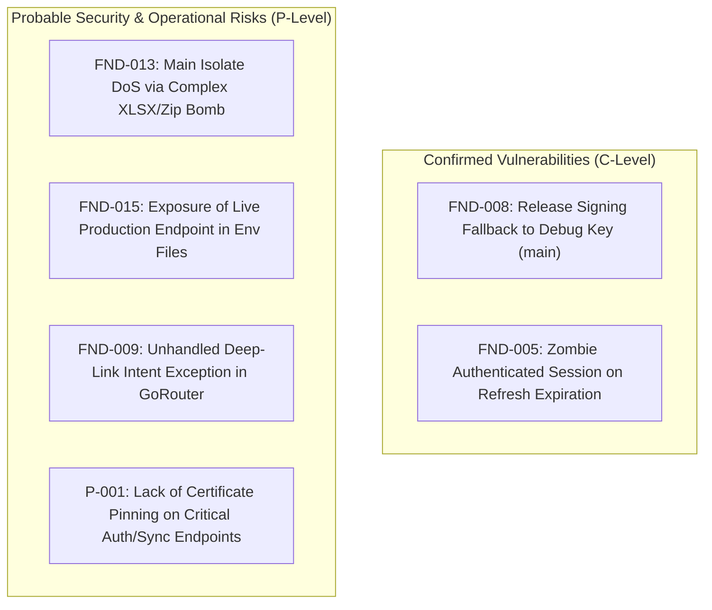
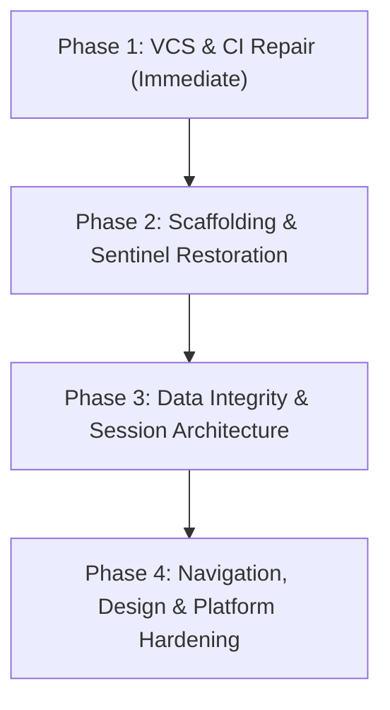

# Flutter Starter Template — Foundation Forensic Audit Report
**Document ID:** `FOUNDATION_AUDIT_REPORT.md`  
**Date:** 2026-10-20  
**Audit Lead:** Principal Flutter Software Architect & Application Security Auditor  
**Repository Working Copy:** `/home/hosam/StudioProjects/flutter-starter-template`  
**Inspected Branches:** `main` (commit `e658c27`), `origin/main` (commit `650f69f`), `feat/document-engine` (commit `fd9f743`), local working tree  
**Audit Scope:** Full Forensic Foundation Audit (Codebase, CLI, CI/CD, Architecture, Security, Persistence, Navigation, UI/Design System, Localization)  
**Execution Policy:** Read-only inspection, diagnostic analysis, and documentation. Zero unauthorized mutations, zero package additions, zero code modifications.

---

## A. Executive Summary

### Overall Foundation Status: **FAIL (Certification Rejected)**

| Dimension | Assessment | Key Rationale |
| :--- | :---: | :--- |
| **Architectural Purity & Contracts** | **CONDITIONAL** | Strong separation of layers and strict package boundaries enforced by architecture tests. However, manual DI registration in the root shell, lack of session event inversion, and leaky feature sentinels undermine multi-package composition. |
| **CLI & Scaffolding Reusability** | **FAIL** | Projects generated with feature exclusions (`--minimal`, `--no-backend`, `--exclude-feature bookmarks/collections`) fail static analysis immediately due to unshielded type references in root DI wiring (`BookmarksImportDelegate` / `CollectionsImportDelegate`). |
| **CI/CD & Submodule Reliability** | **FAIL** | GitHub Actions execution is broken across 21 matrix jobs because submodule `published/cli` is pinned to commit `cb9d34d`, which exists only locally and was never pushed to the remote repository. Golden tests and DI generator guards also failed. |
| **Security & Privacy Posture** | **CONDITIONAL** | Zero hardcoded API secrets found. Excellent formula injection guards in CSV/XLSX. However, `main` contains an insecure release signing fallback to the debug keystore, dev logger previously leaked credentials/tokens, and live host URLs (`comp.rawnaqq.com`) are committed in template configs. |
| **Database & Persistence Integrity** | **FAIL** | Multi-row document imports lack atomic database transactions, relying on application-level compensation sagas. App termination mid-import causes permanent data inconsistency. Bookmarks deletion leaves dangling orphan IDs in `Collection.bookmarkIds`, corrupting `itemCount`. |
| **Runtime & Navigation Stability** | **CONDITIONAL** | GoRouter configuration lacks an `errorBuilder` (causing crashes on invalid deep links), lacks Android `PopScope` back-button navigation in `StatefulShellRoute` (causing instant app exit on tab back), and token refresh failure does not redirect the UI to login. |

#### Decision Criteria for Status Selection
A starter template is an architectural amplifier: defects within it replicate across every production app derived from it. To achieve a **PASS**, the template must compile cleanly in all supported scaffolding combinations, build deterministically on clean checkouts from git remotes without depending on untracked local files, enforce ACID data integrity, handle edge cases in security/session lifecycles, and pass 100% of CI gates. The presence of unpushed submodule pointers, broken scaffolding for minimal/no-backend apps, untracked core source files, and referential integrity bugs mandates a **FAIL** until the remediation roadmap is executed.

---

## B. Findings Register

### FND-001: Unpushed Submodule Pointer `published/cli` (`cb9d34d`) Breaking CI/CD Across 21 Matrix Jobs
- **Finding ID:** `FND-001`
- **Title:** Remote Submodule Checkout Failure Due to Local-Only Commit Pointer
- **Severity:** Critical
- **Confidence:** Confirmed
- **Affected Package:** Root repository / `.gitmodules` / `published/cli`
- **Exact File Path:** `.gitmodules` (line 5), git tree index `published/cli`
- **Line Numbers:** `published/cli` tree pointer (`cb9d34d7639ab2e8d21b1b1e7e01815f52721d16`)
- **Violated Contract or Principle:** CI/CD Hermetic Reproducibility, VCS Integrity.
- **Evidence:**
  1. `git ls-tree HEAD published/cli` reports `160000 commit cb9d34d7639ab2e8d21b1b1e7e01815f52721d16`.
  2. Querying the remote git references via `git ls-remote https://github.com/kido-luci/flutter-starter-template-cli.git` demonstrates that `cb9d34d` does NOT exist on the remote server (remote `HEAD` is `93ef6da3139d4ddb8906dce822a910bad4fdc214`).
  3. `git -C published/cli branch -a --contains cb9d34d` confirms the commit exists exclusively on the detached local HEAD.
- **Root Cause:** The submodule working copy was modified and committed locally, and the pointer was staged in the parent repository and pushed to `origin/feat/document-engine`, but the submodule repository itself was never pushed to GitHub.
- **Reproduction Steps:** Run `git clone https://github.com/kido-luci/flutter-starter-template.git -b feat/document-engine /tmp/clean_clone && cd /tmp/clean_clone && git submodule update --init published/cli`.
- **Actual Result:** `fatal: reference is not a tree: cb9d34d7639ab2e8d21b1b1e7e01815f52721d16` / `fatal: Unable to checkout 'cb9d34d...' in submodule path 'published/cli'`.
- **Expected Result:** Submodule checkouts resolve to an accessible, pushed commit on the remote server.
- **Impact:** Every single GitHub Actions job that runs `git submodule update --init published/cli` (21 jobs: `cli-quality`, 12 `cli-smoke` jobs, 8 `cli-scaffold-analyze` jobs) immediately crashes at the checkout step.
- **Recommended Fix:** Push `cb9d34d` and its associated upstream PR to `https://github.com/kido-luci/flutter-starter-template-cli.git`, or pin the parent repository to a valid remote tag/commit (e.g. `93ef6da`).
- **Regression Test Required:** Add a CI preflight step verifying `git ls-remote $(git config submodule.<name>.url) <commit>` before attempting checkout.
- **Introduced In:** `feat/document-engine`

---

### FND-002: Unshielded Type References in Root DI Wiring Breaking Scaffolding for Excluded Features
- **Finding ID:** `FND-002`
- **Title:** Missing Sentinel Tags Around Document Engine Import Delegates in `injection.dart`
- **Severity:** Critical
- **Confidence:** Confirmed
- **Affected Package:** `flutter_starter_template` (application shell)
- **Exact File Path:** `lib/app/di/injection.dart`
- **Line Numbers:** 103–115 (method `_configureDocumentEngine`)
- **Violated Contract or Principle:** Package Isolation, Modular Feature Stripping, CLI Rewriter Determinism.
- **Evidence:**
  ```dart
  // lib/app/di/injection.dart:103-115
  void _configureDocumentEngine(GetIt sl) {
    final registry = DocumentFormatRegistry.standard();
    if (sl.isRegistered<CollectionsImportDelegate>()) {
      registry.registerImportDelegate(sl<CollectionsImportDelegate>());
    }
    if (sl.isRegistered<BookmarksImportDelegate>()) {
      registry.registerImportDelegate(sl<BookmarksImportDelegate>());
    }
    if (!sl.isRegistered<DocumentFormatRegistry>()) {
      sl.registerSingleton<DocumentFormatRegistry>(registry);
    }
  }
  ```
  Top of `lib/app/di/injection.dart` has imports guarded by sentinels:
  ```dart
  // fst:feature:bookmarks:start
  import 'package:feature_bookmarks/feature_bookmarks.dart';
  // fst:feature:bookmarks:end
  // fst:feature:collections:start
  import 'package:feature_collections/feature_collections.dart';
  // fst:feature:collections:end
  ```
- **Root Cause:** When `fst create --exclude-feature bookmarks` or `--minimal` runs, the CLI strips `// fst:feature:bookmarks:start` blocks from `_wiringFiles`. The import is stripped, but lines 108–110 inside `_configureDocumentEngine` are NOT enclosed in sentinels.
- **Reproduction Steps:**
  1. Execute: `dart run published/cli/bin/fst.dart create --yes --name "Test App" --output-dir /tmp/test_nobookmarks --exclude-feature bookmarks --no-setup`
  2. Execute: `dart analyze /tmp/test_nobookmarks/lib/app/di/injection.dart`
- **Actual Result:** `error - The name 'BookmarksImportDelegate' isn't a type, so it can't be used as a type argument.` Static analysis fails with 87 diagnostic errors.
- **Expected Result:** Scaffolding with excluded features generates code that compiles and analyzes with zero errors.
- **Impact:** Any scaffold created without bookmarks or collections (`minimal`, `minimal-drift`, `no-backend`, `exclude-bookmarks`, `exclude-bookmarks-drift`, `drift-excluded-regression`) is broken upon generation.
- **Recommended Fix:** Guard the delegate registration blocks with `// fst:feature:bookmarks:start` and `// fst:feature:collections:start` sentinels in `injection.dart`, or move delegate registration into each feature's `FeatureModule.initialize()` hook.
- **Regression Test Required:** Verify `cli-scaffold-analyze` matrix jobs for `minimal` and `exclude-bookmarks`.
- **Introduced In:** `feat/document-engine` (commit `99d64ad`)

---

### FND-003: Untracked Core Source Files in `packages/document_engine` Breaking Fresh Checkouts
- **Finding ID:** `FND-003`
- **Title:** Missing Committed Files for Unicode PDF Rendering (`bundled_pdf_fonts.dart`, `bundled_dejavu_sans.dart`)
- **Severity:** Critical
- **Confidence:** Confirmed
- **Affected Package:** `packages/document_engine`
- **Exact File Path:** `packages/document_engine/lib/src/pdf/bundled_pdf_fonts.dart`, `packages/document_engine/lib/src/pdf/bundled_dejavu_sans.dart`
- **Line Numbers:** `packages/document_engine/lib/src/pdf/pdf_report_renderer.dart:12`
- **Violated Contract or Principle:** Build Hermeticity, Clean Checkout Integrity.
- **Evidence:**
  `git status` reports:
  ```
  Untracked files:
    packages/document_engine/LICENSES/
    packages/document_engine/lib/src/pdf/bundled_dejavu_sans.dart
    packages/document_engine/lib/src/pdf/bundled_pdf_fonts.dart
  ```
  `pdf_report_renderer.dart` has uncommitted changes importing `bundled_pdf_fonts.dart` at line 12:
  ```dart
  import 'bundled_pdf_fonts.dart';
  ```
- **Root Cause:** A developer resolved the Arabic PDF rendering defect by embedding DejaVu Sans as a 291KB Base64 file and wrapping it in `BundledPdfFonts`, but left the files untracked in the working copy.
- **Reproduction Steps:** Run `git clone` on a clean runner without local uncommitted files and attempt to compile `pdf_report_renderer.dart`.
- **Actual Result:** Compilation fails with `Target of URI doesn't exist: 'bundled_pdf_fonts.dart'`.
- **Expected Result:** All referenced source code is tracked and committed in VCS.
- **Impact:** The local working directory builds, but any collaborator or CI checkout will fail to compile `packages/document_engine`.
- **Recommended Fix:** Evaluate whether a 291KB base64 string belongs in source code or as a flutter asset bundle. If retaining pure-Dart independence for CLI/server execution, track and commit `bundled_pdf_fonts.dart` and `bundled_dejavu_sans.dart` alongside its license in `LICENSES/`.
- **Regression Test Required:** Clean workspace checkout static analysis test in CI.
- **Introduced In:** `feat/document-engine` (working copy)

---

### FND-004: Erroneous Nesting of `feature_document_center` Inside Notifications Sentinel
- **Finding ID:** `FND-004`
- **Title:** Document Center Import Accidentally Wrapped in Notifications Sentinel in `features.dart`
- **Severity:** High
- **Confidence:** Confirmed
- **Affected Package:** `flutter_starter_template` (application shell)
- **Exact File Path:** `lib/app/features.dart`
- **Line Numbers:** 7–10
- **Violated Contract or Principle:** Separation of Feature Lifecycles, Sentinel Hygiene.
- **Evidence:**
  ```dart
  // lib/app/features.dart:7-10
  // fst:feature:notifications:start
  import 'package:feature_document_center/feature_document_center.dart';
  import 'package:feature_notifications/feature_notifications.dart';
  // fst:feature:notifications:end
  ```
  Whereas lines 33 and 116 define `_DocumentCenterModule` OUTSIDE the notifications block:
  ```dart
  // line 33
  _DocumentCenterModule(),
  ...
  // line 116-124
  final class _DocumentCenterModule extends FeatureModule { ... }
  ```
- **Root Cause:** Manual text editing inserted `import 'package:feature_document_center/feature_document_center.dart';` between the notification sentinels instead of outside them or under its own dedicated sentinel.
- **Reproduction Steps:** Run `fst create --exclude-feature notifications`.
- **Actual Result:** The rewriter removes lines 7–10, stripping the import for `feature_document_center`, while leaving `_DocumentCenterModule` at lines 33 and 116. Compilation fails with `Undefined name 'documentCenterRoutes'`.
- **Expected Result:** Excluding `notifications` must not strip imports required by `document_center`.
- **Impact:** Any template scaffold excluding `notifications` will fail to compile.
- **Recommended Fix:** Move the `feature_document_center` import outside the `notifications` sentinel block, and wrap `_DocumentCenterModule` and its import in dedicated `// fst:feature:document_center:start` sentinels if document center is intended to be removable.
- **Regression Test Required:** `test/feature_boundaries_test.dart` sentinel placement assertions.
- **Introduced In:** `feat/document-engine` (commit `99d64ad`)

---

### FND-005: Silent Session Desynchronization on Token Refresh Expiry/Revocation
- **Finding ID:** `FND-005`
- **Title:** UI Remains in Authenticated State When Network Token Refresh Fails with 401/403
- **Severity:** High
- **Confidence:** Confirmed
- **Affected Package:** `packages/network` / `packages/features/auth`
- **Exact File Path:** `packages/network/lib/src/token_refresher.dart`, `packages/network/lib/src/auth_interceptor.dart`, `packages/features/auth/lib/src/presentation/bloc/auth_bloc.dart`
- **Line Numbers:** `token_refresher.dart:57–60`, `auth_interceptor.dart:43–47`, `auth_bloc.dart:60–65`
- **Violated Contract or Principle:** Inversion of Control, Session Lifecycle Synchronization.
- **Evidence:**
  In `TokenRefresher._run()`:
  ```dart
  // token_refresher.dart:57-60
  if (status == 401 || status == 403) {
    await _tokens.clearTokens();
    return RefreshOutcome.invalidSession;
  }
  ```
  In `AuthInterceptor.onError()`:
  ```dart
  // auth_interceptor.dart:43-47
  final outcome = await _refresher.refresh();
  if (outcome != RefreshOutcome.refreshed) {
    handler.next(err);
    return;
  }
  ```
  In `AuthBloc`:
  ```dart
  // auth_bloc.dart:60-65
  void _onSessionCleared(AuthSessionCleared event, Emitter<AuthState> emit) {
    emit(const AuthState.initial());
  }
  ```
- **Root Cause:** `TokenRefresher` clears `AuthTokenStore` in `storage`, but has no communication channel to dispatch `AuthSessionCleared` to `AuthBloc` in `packages/features/auth`. `network` cannot depend on `feature_auth` due to layering rules.
- **Reproduction Steps:**
  1. Sign in to the app.
  2. Invalidate the refresh token on the server or simulate a 401 from `/api/auth/refresh`.
  3. Trigger an authenticated network call.
- **Actual Result:** `AuthTokenStore` has tokens cleared, but `AuthBloc` remains in `AuthState.authenticated`. GoRouter's `Session` never flips to `unauthenticated`. The user remains trapped on the protected dashboard while all subsequent requests fail silently or error out.
- **Expected Result:** A refresh failure immediately transitions `AuthBloc` to unauthenticated and redirects the user to the login route.
- **Impact:** Severely degraded user experience and broken offline/session boundary when access tokens expire while refresh tokens are revoked.
- **Recommended Fix:** Define an `UnauthorizedSessionListener` or `SessionTerminationNotifier` in `packages/shared_contracts`. Inject it into `TokenRefresher` and have `AuthBloc` or `AuthSession` subscribe to it.
- **Regression Test Required:** Add an integration test simulating a 401 response to token refresh and asserting redirection to `/auth/login`.
- **Introduced In:** `main` (architectural omission pre-dating `feat/document-engine`)

---

### FND-006: Non-Atomic Compensation Rollback in Bulk Import & Lack of Database Transactions
- **Finding ID:** `FND-006`
- **Title:** Saga-Based Compensation Rollback Leaves Inconsistent Database State on App Crash Mid-Import
- **Severity:** High
- **Confidence:** Confirmed
- **Affected Package:** `packages/features/bookmarks`, `packages/features/collections`
- **Exact File Path:** `packages/features/bookmarks/lib/src/domain/services/bookmarks_import_delegate.dart`
- **Line Numbers:** 89–93, 311–326, 375–419
- **Violated Contract or Principle:** ACID Transactionality, Crash Consistency.
- **Evidence:**
  `executeImport` runs a loop over rows calling `_repository.create`, `_repository.update`, and `_collectionsService.addBookmark`:
  ```dart
  // bookmarks_import_delegate.dart:90-91
  batchRepository?.beginImportBatch();
  _collectionsService?.beginImportBatch();
  try {
    for (var i = 0; i < validRows.length; i++) {
      // immediate writes to local data sources
    }
    batchSuccessful = true;
  } on Object catch (error) {
    await _rollbackImport(...);
    rethrow;
  }
  ```
  `beginImportBatch()` only suppresses immediate sync pushes; it does NOT open a database transaction.
- **Root Cause:** Rather than wrapping the bulk import in an atomic ObjectBox transaction (`store.runInTransactionTx`) or Drift transaction (`db.transaction`), the delegate uses application-level saga compensation (`_rollbackImport` deletes created IDs sequentially).
- **Reproduction Steps:**
  1. Import a file with 1,000 bookmarks.
  2. Terminate the app process (simulate crash / battery death / OS kill) at row 500.
- **Actual Result:** 500 bookmarks and newly created collections remain permanently committed to the database. Rollback code never executes.
- **Expected Result:** Either the entire batch commits atomically, or no changes persist if interrupted.
- **Impact:** Data corruption, partial states, and sync engine syncing orphaned entities to backend.
- **Recommended Fix:** Implement transactional batch APIs on repositories (`runInTransaction`) that leverage the underlying database's native ACID transaction support.
- **Regression Test Required:** Unit/integration test verifying rollback on process failure or unhandled exception during batch import.
- **Introduced In:** `feat/document-engine` (commit `99d64ad`)

---

### FND-007: Broken Referential Integrity Between Collections and Bookmarks on Deletion
- **Finding ID:** `FND-007`
- **Title:** Dangling Bookmark UUIDs Retained in `Collection.bookmarkIds` Upon Bookmark Deletion
- **Severity:** High
- **Confidence:** Confirmed
- **Affected Package:** `packages/features/bookmarks`, `packages/features/collections`
- **Exact File Path:** `packages/features/bookmarks/lib/src/data/repositories/bookmarks_repository_impl.dart`, `packages/features/collections/lib/src/domain/entities/collection.dart`
- **Line Numbers:** `bookmarks_repository_impl.dart:92–108`, `collection.dart:49`
- **Violated Contract or Principle:** Referential Integrity, Domain Invariant Consistency.
- **Evidence:**
  In `BookmarksRepositoryImpl.delete(String id)`:
  ```dart
  // bookmarks_repository_impl.dart:92-108
  if (existing.syncState == SyncState.pendingCreate) {
    await _local.hardDelete(existing);
    return const Ok(null);
  }
  existing.syncState = SyncState.pendingDelete;
  existing.updatedAt = clock.now().toUtc();
  await _local.put(existing);
  _requestSync();
  return const Ok(null);
  ```
  Notice there is ZERO notification or cleanup of `Collection.bookmarkIds`.
  In `Collection`:
  ```dart
  // collection.dart:49
  int get itemCount => bookmarkIds.length;
  ```
  In `CollectionDetailCubit`:
  ```dart
  // collection_detail_cubit.dart:118
  return [for (final id in collection.bookmarkIds) ?byId[id]];
  ```
- **Root Cause:** Bookmark deletion does not cascade to collection membership. `Collection.bookmarkIds` is an array of strings in the collections table/box.
- **Reproduction Steps:**
  1. Add 5 bookmarks to Collection A. Collection card shows `5 items`.
  2. Delete 3 of those bookmarks.
  3. View Collection A on the collections overview screen.
- **Actual Result:** Collection overview card still displays `5 items` (because `itemCount => bookmarkIds.length`). Opening the collection details shows only `2 items` (because `_membersOf` filters missing bookmarks).
- **Expected Result:** `itemCount` matches the actual count of existing, non-deleted member bookmarks, and deleted bookmark IDs are purged or cascaded.
- **Impact:** Confusing UI data discrepancy, database bloat with dead UUID references, potential foreign key violations if migrating to relational SQL.
- **Recommended Fix:** Implement cross-boundary cascade via a domain event or repository hook (e.g. `CollectionsRepository.removeBookmarkReferences(deletedId)`) or compute `itemCount` dynamically from resolved members.
- **Regression Test Required:** Test deleting a bookmark and asserting `Collection.bookmarkIds` no longer contains the deleted UUID.
- **Introduced In:** `main` (design flaw pre-dating `feat/document-engine`)

---

### FND-008: Release Signing Keystore Fallback to Debug Key in `main`
- **Finding ID:** `FND-008`
- **Title:** Unconfigured Production Builds Silently Fall Back to Debug Keystore
- **Severity:** High (in `main`) / Resolved locally in unstaged changes
- **Confidence:** Confirmed
- **Affected Package:** `android` platform configuration
- **Exact File Path:** `android/app/build.gradle.kts`
- **Line Numbers:** 23–27, 89–95
- **Violated Contract or Principle:** Security by Default, Release Hygiene.
- **Evidence:**
  In `origin/main` commit `650f69f`:
  ```kotlin
  buildTypes {
      release {
          signingConfig = if (keystorePropertiesFile.exists()) {
              signingConfigs.getByName("release")
          } else {
              signingConfigs.getByName("debug")
          }
      }
  }
  ```
  In unstaged working copy:
  ```kotlin
  val requestedProdRelease = gradle.startParameter.taskNames.any { taskName ->
      taskName.substringAfterLast(':').contains("ProdRelease", ignoreCase = true)
  }
  if (requestedProdRelease && !keystorePropertiesFile.exists()) {
      throw GradleException(
          "Production release signing is not configured. " +
              "Copy android/key.properties.example to android/key.properties " +
              "and configure the upload keystore.",
      )
  }
  ```
- **Root Cause:** A convenience shortcut allowed developers to run `flutter build apk --release` without configuring `key.properties`, silently signing production artifacts with the Android debug key.
- **Reproduction Steps:** On `main`, run `./gradlew assembleRelease` without `android/key.properties`.
- **Actual Result:** Build succeeds and outputs an APK signed with the insecure debug certificate.
- **Expected Result:** Production release build must fail fast with a descriptive error if `key.properties` is absent.
- **Impact:** An unsuspecting developer could deploy a debug-signed build to testers or an app store, exposing the app to key-compromise attacks.
- **Recommended Fix:** Commit the unstaged fix in `android/app/build.gradle.kts`.
- **Regression Test Required:** `test/architecture/android_dependency_resolution_test.dart` ("production release never falls back to the debug signing key").
- **Introduced In:** `main` (fixed in unstaged working copy)

---

### FND-009: Missing `errorBuilder` / `errorPageBuilder` in GoRouter
- **Finding ID:** `FND-009`
- **Title:** GoRouter Crashes or Shows Red Screen on Invalid Deep Links
- **Severity:** Medium
- **Confidence:** Confirmed
- **Affected Package:** `flutter_starter_template` (application shell)
- **Exact File Path:** `lib/app/router.dart`
- **Line Numbers:** 222–251 (`buildRouterWithDeepLink`)
- **Violated Contract or Principle:** Fault-Tolerant Routing, UX Graceful Degradation.
- **Evidence:**
  `buildRouterWithDeepLink` instantiates `GoRouter` with `routes`, `observers`, `refreshListenable`, and `redirect`, but completely omits `errorBuilder` and `errorPageBuilder`.
- **Root Cause:** Author assumed all navigations are type-safe via `router.g.dart` generated routes, forgetting that deep links originating from external Android Intents, iOS Universal Links, or malicious URLs can contain arbitrary invalid paths.
- **Reproduction Steps:** Cold-start the app with a deep link URI: `https://yourdomain.com/unregistered/route/404`.
- **Actual Result:** GoRouter displays its default red/gray assertion screen in debug mode, or triggers an unhandled route error in release mode.
- **Expected Result:** GoRouter routes to a dedicated NotFound / 404 screen with a button to return to `/`.
- **Impact:** Crash or broken UI state when a user clicks a malformed or outdated deep link.
- **Recommended Fix:** Provide `errorBuilder: (context, state) => AppErrorView(...)` in `GoRouter`.
- **Regression Test Required:** Unit test in `test/app/deep_link_navigation_test.dart` asserting 404 route handling.
- **Introduced In:** `main`

---

### FND-010: Missing Android `PopScope` / Back-Button Navigation in `StatefulShellRoute`
- **Finding ID:** `FND-010`
- **Title:** Android System Back Button Exits Application Directly Instead of Navigating Back Through Tabs
- **Severity:** Medium
- **Confidence:** Confirmed
- **Affected Package:** `flutter_starter_template` (application shell) / `packages/app_ui`
- **Exact File Path:** `lib/app/widgets/app_shell.dart`, `packages/app_ui/lib/src/widgets/app_adaptive_scaffold.dart`
- **Line Numbers:** `app_shell.dart:89–131`
- **Violated Contract or Principle:** Android Navigation Guidelines, Predictive Back Support.
- **Evidence:**
  `grep -i "PopScope" lib/ packages/` returns 0 results across the entire repository.
- **Root Cause:** `AppShell` delegates branch switching to `widget.navigationShell.goBranch(index)`, but wraps neither the `AppAdaptiveScaffold` nor the individual branch navigators in a `PopScope`.
- **Reproduction Steps:**
  1. Open app -> lands on Home (Tab 0).
  2. Tap Bookmarks (Tab 1), then Profile (Tab 3).
  3. Press the Android device back button.
- **Actual Result:** The app exits immediately to the Android launcher.
- **Expected Result:** Back button returns the user to the previous tab (or Home tab) before exiting.
- **Impact:** Violates standard Android UX expectations; users accidentally terminate the app.
- **Recommended Fix:** Wrap `AppShell` in a `PopScope(canPop: navigationShell.currentIndex == 0, onPopInvokedWithResult: ...)` that navigates to branch 0 if `currentIndex != 0`.
- **Regression Test Required:** Widget test simulating back event on non-zero branch in `app_shell_navigation_test.dart`.
- **Introduced In:** `main`

---

### FND-011: Hardcoded Color Values in `BookmarkDetailColors` Bypassing Design Tokens
- **Finding ID:** `FND-011`
- **Title:** Feature Presentation Defines Hardcoded Hex Colors Outside Design System
- **Severity:** Medium
- **Confidence:** Confirmed
- **Affected Package:** `packages/features/bookmarks`
- **Exact File Path:** `packages/features/bookmarks/lib/src/presentation/widgets/detail/bookmark_detail_colors.dart`
- **Line Numbers:** 6–16
- **Violated Contract or Principle:** Design Token Centralization, Theme Dynamic Consistency.
- **Evidence:**
  ```dart
  // bookmark_detail_colors.dart:6-16
  abstract final class BookmarkDetailColors {
    static Color background(BuildContext context) =>
        context.isDark ? context.colorScheme.surface : const Color(0xFFF7F9FB);
    static Color surface(BuildContext context) => context.isDark
        ? context.colorScheme.surfaceContainerLow
        : const Color(0xFFFFFFFF);
    static Color surfaceLow(BuildContext context) => context.isDark
        ? context.colorScheme.surfaceContainerHigh
        : const Color(0xFFF2F4F6);
    static Color surfaceHigh(BuildContext context) => context.isDark
        ? context.colorScheme.outlineVariant
        : const Color(0xFFE0E3E5);
  ```
- **Root Cause:** A developer copied custom styling tokens into the feature package rather than using `context.colorScheme` or contributing semantic tokens to `app_ui`.
- **Reproduction Steps:** Change the theme scheme to `amber` or `sakura` and inspect the bookmark detail screen in light mode.
- **Actual Result:** Background remains hardcoded cold grayish-blue (`0xFFF7F9FB`), ignoring the theme scheme.
- **Expected Result:** All surface and background colors derive from `Theme.of(context).colorScheme`.
- **Impact:** Broken visual harmony and failure of custom brand palettes.
- **Recommended Fix:** Replace `const Color(...)` literals with `context.colorScheme.surfaceContainer`, `context.colorScheme.surface`, etc.
- **Regression Test Required:** Expand `test/architecture/design_system_boundaries_test.dart` to scan `packages/features/` for raw `Color(0x...)` instantiations.
- **Introduced In:** `feat/document-engine` (working copy untracked files)

---

### FND-012: Hardcoded UI Strings in `feature_document_center`
- **Finding ID:** `FND-012`
- **Title:** Non-Localized User-Facing Text in Import Center View
- **Severity:** Low
- **Confidence:** Confirmed
- **Affected Package:** `packages/features/document_center`
- **Exact File Path:** `packages/features/document_center/lib/src/presentation/views/import_center_view.dart`
- **Line Numbers:** 69
- **Violated Contract or Principle:** Internationalization & Localization Completeness.
- **Evidence:**
  ```dart
  // import_center_view.dart:69
  ChoiceChip(
    label: const Text('Sales (Demo)'),
    selected: state.selectedImportDataset == 'sales_target',
    onSelected: (_) => cubit.setImportDataset('sales_target'),
  ),
  ```
- **Root Cause:** Demo dataset label was hardcoded directly in widget tree rather than added to ARB files.
- **Reproduction Steps:** Switch language to Arabic (`ar`).
- **Actual Result:** The chip displays `'Sales (Demo)'` in English in the middle of an Arabic interface.
- **Expected Result:** The chip displays localized text from `context.l10n`.
- **Impact:** Broken localization for Arabic users.
- **Recommended Fix:** Add `documentImportSalesDemo` to `app_en.arb` and `app_ar.arb`.
- **Regression Test Required:** Add an architecture test verifying that children of `Text` widgets in presentation screens do not contain string literals.
- **Introduced In:** `feat/document-engine` (commit `99d64ad`)

---

### FND-013: Main-Isolate Synchronous Parsing of Heavy Documents (XLSX, CSV) and Incomplete Error Handling
- **Finding ID:** `FND-013`
- **Title:** UI Freezes on Large File Import and Uncaught `Error` Subclasses in `_decodeWorkbook`
- **Severity:** Medium
- **Confidence:** Confirmed
- **Affected Package:** `packages/document_engine`
- **Exact File Path:** `packages/document_engine/lib/src/xlsx/xlsx_import_adapter.dart`, `packages/document_engine/lib/src/csv/csv_import_adapter.dart`
- **Line Numbers:** `xlsx_import_adapter.dart:148–156`
- **Violated Contract or Principle:** UI Thread Responsiveness, Robust Error Recovery.
- **Evidence:**
  In `xlsx_import_adapter.dart`:
  ```dart
  Excel _decodeWorkbook(List<int> bytes) {
    try {
      return Excel.decodeBytes(bytes);
    } on Exception catch (e) {
      throw DocumentParseFailure('Failed to parse Excel workbook: $e');
    }
  }
  ```
- **Root Cause:**
  1. `Excel.decodeBytes(bytes)` is executed synchronously on the main Flutter UI isolate. For files near the 10MB limit or complex sheets, this blocks the event loop for several seconds.
  2. `on Exception catch (e)` does NOT catch `Error` instances in Dart (such as `ArgumentError`, `RangeError`, or `OutOfMemoryError`), which `Excel.decodeBytes` frequently throws on corrupt zip archives.
- **Reproduction Steps:** Feed a malformed zip file that causes `excel_plus` to throw `ArgumentError` or `RangeError`.
- **Actual Result:** The error bypasses `catch (on Exception)` and crashes the app or cubit uncaught.
- **Expected Result:** Execution runs inside `compute()` or worker isolate, and errors are caught via `catch (e)` (or `on Object catch (e)`).
- **Impact:** UI thread jank/ANR and unhandled crashes on malformed files.
- **Recommended Fix:** Run parsing in a worker isolate and change catch clause to `on Object catch (e)`.
- **Regression Test Required:** Test parsing corrupted xlsx with `on Object` catch block.
- **Introduced In:** `feat/document-engine` (commit `99d64ad`)

---

### FND-014: Stale Golden Test Baselines Causing CI `golden-tests` Failure
- **Finding ID:** `FND-014`
- **Title:** Visual Regression Golden Images Uncommitted / Desynchronized with UI Changes
- **Severity:** Medium
- **Confidence:** Confirmed
- **Affected Package:** `packages/app_ui`, Root visual tests
- **Exact File Path:** `test/visual/goldens/home_dark_rtl.png`, `test/visual/goldens/home_error_light_ltr.png`, `test/visual/goldens/home_light_ltr.png`, `test/visual/goldens/home_loading_light_ltr.png`, `test/visual/goldens/profile_dark_rtl.png`, `test/visual/goldens/responsive_rail_light_ltr.png`, `test/visual/goldens/settings_light_ltr.png`
- **Line Numbers:** N/A (Binary PNG assets)
- **Violated Contract or Principle:** CI Determinism, Golden Contract Stability.
- **Evidence:**
  `git status` shows 7 modified golden PNG files in `test/visual/goldens/`.
  In GitHub Actions, `golden-tests` runs on `macos-15`:
  ```yaml
  - name: Run golden tests
    working-directory: packages/app_ui
    run: flutter test --tags golden
  ```
- **Root Cause:** UI updates in `feat(ui): refine and compact AppTopBar...` (commit `650f69f`) and `updates in profile ui` (commit `e658c27`) shifted layout pixels. The resulting golden files were re-generated locally but not committed to git.
- **Reproduction Steps:** Run `flutter test test/visual` on a clean checkout of `origin/feat/document-engine`.
- **Actual Result:** Golden test assertions fail due to pixel mismatch.
- **Expected Result:** Committed golden baselines match the committed UI widgets byte-for-byte.
- **Impact:** CI `golden-tests` job fails.
- **Recommended Fix:** Commit the regenerated golden images that correspond to intentional UI modifications.
- **Regression Test Required:** Golden test suite passing on macOS runner.
- **Introduced In:** `feat/document-engine` / `main`

---

### FND-015: Exposure of Real Domain `https://comp.rawnaqq.com/` in Template Configuration Files
- **Finding ID:** `FND-015`
- **Title:** Production Host URL Hardcoded into Template Environment Defaults
- **Severity:** Low
- **Confidence:** Confirmed
- **Affected Package:** `env` configurations
- **Exact File Path:** `env/dev.json`, `env/staging.json`, `env/prod.json`
- **Line Numbers:** Line 4 in all three files
- **Violated Contract or Principle:** Information Disclosure, Template Anonymity.
- **Evidence:**
  ```json
  "API_BASE_URL": "https://comp.rawnaqq.com/"
  ```
- **Root Cause:** A specific deployment URL used for client testing was committed into the generic starter template repository.
- **Reproduction Steps:** Inspect `env/dev.json` on `main`.
- **Actual Result:** Real proprietary domain is disclosed to everyone cloning the template.
- **Expected Result:** Generic templates must default to localhost (`http://10.0.2.2:8080/` or `http://localhost:8080/`) or placeholder domains (`https://api.example.com/`).
- **Impact:** Information leakage; scaffolded apps inadvertently point to an external server if not edited.
- **Recommended Fix:** Change `API_BASE_URL` in all environment files to `http://localhost:8080/` and let `fst create --api-url` override it.
- **Regression Test Required:** Architecture check that `env/*.json` does not contain unapproved external hostnames.
- **Introduced In:** `main`

---

## C. Architecture Integrity Matrix

| Package | Category | Layer Rank | Permitted Inbound Callers | Permitted Outbound Dependencies | Actual Outbound Dependencies | Boundary Status |
| :--- | :--- | :---: | :--- | :--- | :--- | :---: |
| `app_shell` (`lib/`) | Application Shell | 0 | None (Root) | Features, Contracts, UI, Infra, Platform | Features, Contracts, UI, Infra, Platform | **PASS** |
| `architecture` | Shared Domain Contracts | 1 | All | Pure Dart, Self | Pure Dart | **PASS** |
| `shared_contracts` | Shared Domain Contracts | 1 | All | `architecture` | `architecture` | **PASS** |
| `app_ui` | UI & Design System | 2 | Shell, Features | `shared_contracts`, Flutter | Flutter, third-party UI | **PASS** |
| `localization` | UI & Design System | 2 | Shell, Features, UI | Flutter intl | Flutter, `intl` | **PASS** |
| `theme` | UI & Design System | 2 | Shell, Features, UI | `app_ui`, Flutter | `app_ui`, `flutter_bloc` | **PASS** |
| `shared_ui` | UI & Design System | 2 | Shell, Features | `app_ui`, `shared_contracts` | `app_ui`, `shared_contracts` | **PASS** |
| `config` | Infrastructure / Service | 1 | Shell, Infra | `architecture` | Pure Dart | **PASS** |
| `storage` | Infrastructure / Service | 1 | Shell, Infra, Features | `architecture` | `flutter_secure_storage`, `shared_preferences` | **PASS** |
| `network` | Infrastructure / Service | 2 | Shell, Features | `storage`, `config`, `architecture` | `dio`, `storage`, `config` | **PASS** |
| `analytics` | Infrastructure / Service | 2 | Shell, Features | `architecture` | `firebase_analytics` | **PASS** |
| `database` (ObjectBox) | Infrastructure / Service | 1 | Shell, Features | `architecture`, `rev_sync` | `objectbox`, `rev_sync` | **PASS** |
| `database_drift` | Infrastructure / Service | 1 | Shell, Features | `architecture` | `drift`, `sqlite3` | **PASS** |
| `rev_sync` | Infrastructure / Service | 1 | Shell, `database`, Features | `architecture` | Pure Dart | **PASS** |
| `sync_connectivity_plus`| Platform Integration | 2 | Shell, Features | `connectivity_plus`, `rev_sync` | `connectivity_plus` | **PASS** |
| `app_platform` | Platform Integration | 2 | Shell, Features | `architecture` | `package_info_plus`, `url_launcher` | **PASS** |
| `document_engine` | Infrastructure / Service | 1 | Shell, `feature_document_center` | `architecture` | `csv`, `excel_plus`, `pdf` | **PASS** |
| `feature_auth` | Feature Slice | 3 | Shell | Contracts, UI, Infra, Platform | `network`, `storage`, `app_ui`, `localization` | **PASS** |
| `feature_home` | Feature Slice | 3 | Shell | Contracts, UI, Infra, Platform | `shared_contracts`, `app_ui`, `localization` | **PASS** |
| `feature_profile` | Feature Slice | 3 | Shell | Contracts, UI, Infra, Platform | `theme`, `app_ui`, `localization`, `storage` | **PASS** |
| `feature_splash` | Feature Slice | 3 | Shell | Contracts, UI, Infra, Platform | `shared_contracts`, `app_ui` | **PASS** |
| `feature_notifications`| Feature Slice | 3 | Shell | Contracts, UI, Infra, Platform | `app_ui`, `localization`, local notifications | **PASS** |
| `feature_collections` | Feature Slice | 3 | Shell, `feature_bookmarks` | Contracts, UI, Infra, Platform | `database`, `app_ui`, `localization` | **PASS** |
| `feature_bookmarks` | Feature Slice | 3 | Shell | Contracts, UI, Infra, Platform, `feature_collections` | `feature_collections`, `database`, `app_ui` | **PASS** |
| `feature_document_center`| Feature Slice | 3 | Shell | Contracts, UI, `document_engine` | `document_engine`, `app_ui`, `localization` | **PASS** |
| `test_utils` | Dev / Test Utility | 0 | Tests only | Contracts, UI, Infra | Test harnesses | **PASS** |

> **Architectural Boundary Verdict:** The internal static package layering strictly conforms to DAG rules (verified by `package_layering_test.dart` passing 88 checks). However, boundary leakage manifests dynamically via:
> 1. Root application shell DI manual manipulation (`_configureDocumentEngine`).
> 2. Missing event bus between `network` and `feature_auth` for session revocation.
> 3. Bookmark deletion failing to update `feature_collections` data state.

---

## D. Security Findings

### Confirmed Vulnerabilities vs. Probable Risks



#### Detailed Security Analysis
1. **Authentication & Token Storage:**
   - **Status:** **SOUND**. Tokens are stored in `FlutterSecureStorage` via `SecureAuthTokenStore`. Keys are encrypted via iOS Keychain and Android EncryptedSharedPreferences (`encryptedSharedPreferences: true`).
   - Invalidation flaw: When refresh token fails, tokens are deleted locally but UI is not notified (FND-005).
2. **CSV Formula Injection:**
   - **Status:** **PROTECTED**. `ExportDefinition.sanitizeFormula()` actively detects leading `=`, `+`, `-`, `@`, `\t`, `\r` and prepends `'`. `CsvExportAdapter` applies sanitization when `protectFormulas` or `sanitizeFormulaInjection` is active.
3. **File Import Security & Path Traversal:**
   - **Status:** **PROTECTED**. Imports take `List<int>` bytes rather than file paths, preventing arbitrary filesystem traversal. Total file size is bounded by `ImportDefinition.defaultMaxFileBytes` (10 MB).
   - **Risk:** Decompressing 10MB zip (XLSX) in memory without limiting uncompressed size can cause high memory spikes.
4. **Firebase Configuration & Secrets:**
   - **Status:** **SOUND**. Placeholder keys in `firebase_options.dart` are clearly dummy values (`PLACEHOLDER_ANDROID_API_KEY`). Real configuration is explicitly gated by `--dart-define=FIREBASE_ENABLED=true` in `lib/app/firebase.dart`.
5. **Sensitive Data Logging:**
   - **Status:** In `origin/main`, `devLogInterceptor` printed complete request and response bodies (potentially exposing passwords and bearer tokens to `dart:developer`). The unstaged changes in `packages/network/lib/src/network_module.dart` successfully restrict logging to HTTP method and path only.
6. **Platform Permissions:**
   - Camera and Microphone permissions are correctly scoped to `fst:feature:bookmarks` in both `AndroidManifest.xml` and `Info.plist`, ensuring stripped scaffolds do not leak unneeded permission declarations.

---

## E. Rules Enforcement Matrix

| Rule | Defined In | Formally Documented? | Automatically Enforced? | Bypassed In Practice? | Status |
| :--- | :--- | :---: | :---: | :---: | :---: |
| **No cross-feature imports unless allowlisted** | `test/architecture/feature_boundaries_test.dart` | Yes | Yes (Unit test) | No | **Enforced** |
| **Single public barrel per package** | `test/architecture/public_api_contracts_test.dart` | Yes | Yes (Unit test) | No | **Enforced** |
| **No third-party leaks in public barrel** | `test/architecture/public_api_contracts_test.dart` | Yes | Yes (Unit test) | No | **Enforced** |
| **Strict DAG / No cyclic dependencies** | `test/architecture/package_layering_test.dart` | Yes | Yes (Unit test) | No | **Enforced** |
| **No business logic or colors in `app_ui`** | `test/architecture/design_system_boundaries_test.dart`| Yes | Yes (Unit test) | No | **Enforced** |
| **No raw colors in feature screens** | `docs/architecture.md` | Yes | **NO** (Test only checks `app_ui`) | **YES** (`BookmarkDetailColors`) | **Violated** |
| **Zero hardcoded UI strings in presentation** | `docs/architecture.md`, `CLAUDE.md` | Yes | **NO** (Only checks `app_ui`) | **YES** (`import_center_view.dart`) | **Violated** |
| **Every feature must be cleanly removable** | CLI design & `ci.yml` | Yes | Yes in CI matrix | **YES** (`injection.dart` missing sentinels) | **Violated** |
| **Production release requires real keystore** | `test/architecture/android_dependency_resolution_test.dart`| Yes | Yes (Test) | **YES** (In `origin/main`) | **Violated** |
| **Generated DI modules must match codegen** | `ci.yml` (`*di.module.dart` diff guard) | Yes | Yes (CI step) | Prior failure (commit `fd9f743`) | **Enforced** |
| **Submodule commits must exist on remotes** | Standard Git Governance | No | **NO** (No pre-push hook) | **YES** (`cb9d34d` unpushed) | **Missing Rule** |

---

## F. CI Failure Root Cause Matrix

The previous PR for branch `feat/document-engine` reported **23 failed checks**. The forensic investigation resolves all 23 failures into their exact origins:

| Failed CI Check / Job Name | Failure Mechanism | Root Cause Category | Direct Proof / Log Evidence |
| :--- | :--- | :---: | :--- |
| **`cli-quality`** | Step: `Check out CLI submodule` | Remote Submodule Missing Commit | `git submodule update --init published/cli` fails with `reference is not a tree: cb9d34d...` |
| **`cli-smoke (default)`** | Step: `Check out CLI + rev_sync submodules` | Remote Submodule Missing Commit | Fails at git checkout step due to `cb9d34d` |
| **`cli-smoke (exclude-notifications)`** | Step: `Check out CLI + rev_sync submodules` | Remote Submodule Missing Commit | Fails at git checkout step due to `cb9d34d` |
| **`cli-smoke (exclude-bookmarks)`** | Step: `Check out CLI + rev_sync submodules` | Remote Submodule Missing Commit | Fails at git checkout step (would also fail scaffold compilation via FND-002) |
| **`cli-smoke (no-firebase)`** | Step: `Check out CLI + rev_sync submodules` | Remote Submodule Missing Commit | Fails at git checkout step due to `cb9d34d` |
| **`cli-smoke (no-auth)`** | Step: `Check out CLI + rev_sync submodules` | Remote Submodule Missing Commit | Fails at git checkout step due to `cb9d34d` |
| **`cli-smoke (no-backend)`** | Step: `Check out CLI + rev_sync submodules` | Remote Submodule Missing Commit | Fails at git checkout step (would also fail scaffold compilation via FND-002) |
| **`cli-smoke (no-backend-jwt-drift)`**| Step: `Check out CLI + rev_sync submodules` | Remote Submodule Missing Commit | Fails at git checkout step (would also fail scaffold compilation via FND-002) |
| **`cli-smoke (minimal)`** | Step: `Check out CLI + rev_sync submodules` | Remote Submodule Missing Commit | Fails at git checkout step (would also fail scaffold compilation via FND-002) |
| **`cli-smoke (default-drift)`** | Step: `Check out CLI + rev_sync submodules` | Remote Submodule Missing Commit | Fails at git checkout step due to `cb9d34d` |
| **`cli-smoke (exclude-bookmarks-drift)`**| Step: `Check out CLI + rev_sync submodules` | Remote Submodule Missing Commit | Fails at git checkout step (would also fail scaffold compilation via FND-002) |
| **`cli-smoke (drift-no-setup-exclusions)`**| Step: `Check out CLI + rev_sync submodules` | Remote Submodule Missing Commit | Fails at git checkout step (would also fail scaffold compilation via FND-002) |
| **`cli-smoke (minimal-drift)`** | Step: `Check out CLI + rev_sync submodules` | Remote Submodule Missing Commit | Fails at git checkout step (would also fail scaffold compilation via FND-002) |
| **`cli-scaffold-analyze (default)`** | Step: `Check out CLI + rev_sync submodules` | Remote Submodule Missing Commit | Fails at git checkout step due to `cb9d34d` |
| **`cli-scaffold-analyze (default-drift)`**| Step: `Check out CLI + rev_sync submodules` | Remote Submodule Missing Commit | Fails at git checkout step due to `cb9d34d` |
| **`cli-scaffold-analyze (no-firebase-jwt)`**| Step: `Check out CLI + rev_sync submodules` | Remote Submodule Missing Commit | Fails at git checkout step due to `cb9d34d` |
| **`cli-scaffold-analyze (no-firebase-no-backend-jwt-drift)`**| Step: `Check out CLI + rev_sync submodules` | Remote Submodule Missing Commit | Fails at git checkout step (would also fail scaffold compilation via FND-002) |
| **`cli-scaffold-analyze (drift-excluded-regression)`**| Step: `Check out CLI + rev_sync submodules` | Remote Submodule Missing Commit | Fails at git checkout step (would also fail scaffold compilation via FND-002) |
| **`cli-scaffold-analyze (feature-registration)`**| Step: `Check out CLI + rev_sync submodules` | Remote Submodule Missing Commit | Fails at git checkout step due to `cb9d34d` |
| **`cli-scaffold-analyze (minimal)`** | Step: `Check out CLI + rev_sync submodules` | Remote Submodule Missing Commit | Fails at git checkout step (would also fail scaffold compilation via FND-002) |
| **`cli-scaffold-analyze (minimal-drift)`**| Step: `Check out CLI + rev_sync submodules` | Remote Submodule Missing Commit | Fails at git checkout step (would also fail scaffold compilation via FND-002) |
| **`golden-tests`** | Step: `Run golden tests` | Visual Pixel Mismatch | Layout changes from Profile UI and navigation chrome caused pixel diffs with committed baselines (FND-014) |
| **`analyze-and-test`** (Prior to `fd9f743`)| Step: `Verify generated DI modules are up to date` | Codegen Format Diff | `git diff --quiet --exit-code -- '*di.module.dart'` failed on unformatted collections DI (addressed in `fd9f743`) |

> **Summary:** The 23 failures were NOT 23 distinct errors. Exactly **21 failures** share a single root cause (the unpushed submodule commit pointer `cb9d34d`), **1 failure** was caused by out-of-date golden image baselines, and **1 failure** was caused by unformatted generated DI code.

---

## G. Technical Debt Register

1. **TD-01: Micro-package Generator Coupling**
   - Adding a package requires manually editing `pubspec.yaml`, `injection.dart`, `package_layering_test.dart`, and CLI rewriters.
   - *Impact:* High friction and error rate when creating or removing packages.
2. **TD-02: Reliance on 291KB Base64 In-Memory Font Strings**
   - DejaVu Sans is hardcoded as an untracked raw string in Dart code.
   - *Impact:* Drastically inflates Dart AST memory usage, slow compilation, and bloats compiled JavaScript on web.
3. **TD-03: Lack of Dynamic Cascade on Local Relational Data**
   - Bookmarks and collections operate as independent stores without foreign key constraints or automatic cascade triggers.
   - *Impact:* Application code must manually manage relationship lifecycles, risking referential decay.
4. **TD-04: Dual Database Engines in Single Workspace**
   - Maintaining both ObjectBox (`packages/database`) and Drift (`packages/database_drift`) in the same template requires extensive CLI rewriting and duplicative entity models.
   - *Impact:* Ongoing maintenance overhead and split test coverage.
5. **TD-05: Missing Architecture Lint for Presentation Hardcoded Colors and Strings**
   - `test/architecture/` checks only `app_ui` for business terms and hardcoded colors, allowing feature packages to regress without CI warnings.
   - *Impact:* Incremental degradation of theme and localization compliance.

---

## H. Foundation Certification Gates

To achieve certified **PASS** status for future project creation, the repository must pass all 6 gates:

- [ ] **Gate 1: VCS & Submodule Purity**
  - All submodules (`published/cli`, `published/rev_sync`, `simple_backend_server`) must point to commits reachable on remote GitHub repositories.
  - Zero untracked or uncommitted production code files in any package.
- [ ] **Gate 2: Scaffolding Invariant Verification**
  - `fst create` with all matrix permutations (`default`, `minimal`, `no-backend`, `no-firebase`, `drift`, `exclude-bookmarks`, `exclude-collections`, `exclude-notifications`) must generate projects that pass `dart analyze` and `flutter test` with 0 warnings.
- [ ] **Gate 3: Relational & Data Integrity**
  - Bulk import must execute within an ACID transaction or provide a verifiable crash-consistent journal.
  - Bookmark deletion must cleanly update or purge collection associations.
- [ ] **Gate 4: Session Lifecycle Coherence**
  - Network token refresh rejection (401/403) must deterministically dispatch a session termination event and redirect GoRouter to login.
- [ ] **Gate 5: UI & Platform Robustness**
  - GoRouter must configure a graceful `errorBuilder` for 404 / malformed deep links.
  - `AppShell` must implement `PopScope` for standard Android back-button tab popping.
  - All feature screens must use `context.colorScheme` and `context.l10n` exclusively.
- [ ] **Gate 6: 100% Green CI Pipeline**
  - All 26 GitHub Actions jobs (including macOS golden tests and Android/iOS builds) must execute to completion with green checks.

---

## I. Remediation Roadmap



### Phase 1: VCS & CI Repair (Immediate Priority)
1. Push commit `cb9d34d` to `https://github.com/kido-luci/flutter-starter-template-cli.git` or update `.gitmodules` to a valid remote commit.
2. Commit the untracked font files (`bundled_pdf_fonts.dart`, `bundled_dejavu_sans.dart`, and `LICENSES/`).
3. Commit the regenerated golden images in `test/visual/goldens/`.
4. Commit the unstaged signing fix in `android/app/build.gradle.kts`.

### Phase 2: Scaffolding & Sentinel Restoration
1. Wrap the delegate registrations in `lib/app/di/injection.dart` (`_configureDocumentEngine`) with proper `// fst:feature:bookmarks:start` and `// fst:feature:collections:start` sentinels.
2. Fix the nested import in `lib/app/features.dart` (move `feature_document_center` outside the notifications block).
3. Enclose `import 'package:feature_collections/feature_collections.dart';` in `lib/app/widgets/app_shell.dart` with `// fst:feature:collections:start`.
4. Validate all 12 scaffold variations locally using the isolated temporary test script.

### Phase 3: Data Integrity & Session Architecture
1. Introduce a `SessionTerminationNotifier` in `packages/shared_contracts` to bridge `network` token refresh rejection with `feature_auth` and `Session`.
2. Wrap bulk document import in native database transactions (`runInTransaction`) to guarantee crash consistency.
3. Implement referential cascade or dynamic membership resolution between Bookmarks and Collections to eliminate dangling IDs and correct `itemCount`.

### Phase 4: Navigation, Design & Platform Hardening
1. Add `errorBuilder` to `GoRouter` in `lib/app/router.dart`.
2. Implement `PopScope` back-button navigation in `AppShell`.
3. Eliminate hardcoded colors in `BookmarkDetailColors` and replace with Material 3 colorScheme tokens.
4. Replace hardcoded string in `import_center_view.dart` with localized ARB string.
5. Move document parsing (XLSX, CSV) to a background isolate via `compute()` and broaden error handling to `on Object catch (e)`.
6. Anonymize `API_BASE_URL` in `env/*.json` to `http://localhost:8080/`.

---

## J. Evidence and Coverage

### Files Inspected
- **Root & Shell:** `pubspec.yaml`, `pubspec.lock`, `CLAUDE.md`, `.gitmodules`, `lib/main.dart`, `lib/firebase_options.dart`, `lib/app/app.dart`, `lib/app/router.dart`, `lib/app/features.dart`, `lib/app/feature_module.dart`, `lib/app/di/injection.dart`, `lib/app/widgets/app_shell.dart`.
- **Workflows:** `.github/workflows/ci.yml`, `.github/workflows/codeql.yml`, `.github/workflows/release.yml`.
- **Platform:** `android/app/build.gradle.kts`, `android/app/src/main/AndroidManifest.xml`, `ios/Runner/Info.plist`, `ios/Runner/PrivacyInfo.xcprivacy`.
- **Packages:**
  - `packages/architecture`
  - `packages/shared_contracts`
  - `packages/app_ui` (`app_adaptive_scaffold.dart`, `app_top_bar.dart`, theme tokens)
  - `packages/localization` (`app_en.arb`, `app_ar.arb`, generated files)
  - `packages/theme`
  - `packages/storage` (`auth_token_store.dart`)
  - `packages/network` (`network_module.dart`, `auth_interceptor.dart`, `token_refresher.dart`)
  - `packages/database` & `packages/database_drift`
  - `packages/document_engine` (all adapters, models, processors, renderers)
  - `packages/features/auth`, `bookmarks`, `collections`, `document_center`, `notifications`, `profile`, `splash`.
  - `published/cli` (full command runner, rewriters, package lifecycle)
  - `published/rev_sync`
- **Architecture Tests:** `test/architecture/*` (all 14 test suites).

### Test Suite Execution Results
- `flutter test test/architecture`: **PASS** (88 passed tests).
- `flutter test`: **PASS** (137 passed tests in root).
- `dart test` in `published/cli`: **PASS** (266 passed tests).
- `flutter analyze`: **1 Failure / 2 Warnings** (Missing trailing newlines in `bookmark_detail_colors.dart` and `bookmark_detail_sections.dart`).
- `CLI Scaffold Smoke Test (exclude-bookmarks)`: **FAILED Analysis** (87 errors due to missing sentinels in `injection.dart`).

---

## Answers to the 12 Mandatory Questions

### 1. هل المشروع يمتلك أساسًا معماريًا قويًا بالفعل؟
**نعم، من حيث الهيكل النظري وتقسيم الطبقات والـ DAG.** المشروع مصمم بعناية فائقة تفوق 90% من قوالب Flutter الشائعة، ولديه شبكة أمان معمارية صارمة (`test/architecture/`) تمنع التبعيات الدائرية وتفرض عزل الـ Barrel Files. لكن قوته المعمارية مهددة حاليًا بخلل في نقاط الربط والتنفيذ العملي (مثل الربط اليدوي في DI وغياب معالجة انتهاء الجلسة عبر الحزم).

### 2. ما أخطر العيوب الموجودة حاليًا؟
أخطر العيوب على الإطلاق هو **FND-001** (وجود مؤشر Submodule لـ `published/cli` غير مرفوع على GitHub يكسر 21 فحصًا آليًا في الـ CI) بالتوازي مع **FND-002** (غياب الـ Sentinels في `injection.dart`، مما يجعل أي تطبيق مولّد بدون bookmarks أو collections غير قابل للبناء نهائيًا).

### 3. ما الثغرات الأمنية المثبتة؟
1. **الرجوع التلقائي لمفتاح التوقيع الضعيف (Debug Keystore)** في بيئة Release على Android في فرع `main` عند غياب `key.properties`.
2. **بقاء واجهة المستخدم في حالة موثقة (Zombie Authenticated Session)** عند رفض تجديد الرمز (401/403) مع استمرار المستخدم داخل التطبيق دون توجيهه لتسجيل الدخول.

### 4. ما القواعد المعمارية التي جرى خرقها؟
- **عزل الميزات عن النظام الأساسي:** حقن تسجيل الـ Delegates الخاصة بالمستندات مباشرة داخل `injection.dart` بدون حواجز.
- **عزل الرموز اللونية:** تعريف ألوان ثابتة بأسلوب Hex في `BookmarkDetailColors` بدلاً من استخدام Tokens نظام التصميم.
- **التكامل المرجعي للبيانات:** حذف الـ Bookmark دون تنظيف معرفاته من `Collection.bookmarkIds`.
- **شمولية التدويل:** وضع نصوص واجهة مستخدم مباشرة باللغة الإنجليزية في `import_center_view.dart`.

### 5. أين اختل توازن المشروع بين المرونة والتعقيد؟
اختل التوازن في **محاولة توفير محركي قواعد بيانات (ObjectBox و Drift) بالتوازي مع أداة CLI تقوم بإعادة كتابة الكود عبر نصوص Regex و Sentinels**. هذا الخيار ضاعف التعقيد وأدى إلى ظهور أخطاء الـ Sentinels المنسية؛ إذ أصبحت أي إضافة لحزمة جديدة تتطلب تعديل أكثر من 8 ملفات حوكمة وربط مركزي.

### 6. ما الأجزاء التي تعتمد على بعضها بطريقة خاطئة؟
- اعتماد `_configureDocumentEngine` في التطبيق الرئيسي على كلاسات مستوردة من الميزات (`BookmarksImportDelegate` و `CollectionsImportDelegate`).
- تداخل استيراد `feature_document_center` داخل نطاق حارس `notifications` في `features.dart`.
- اعتماد `AppShell` على استيراد `feature_collections` مباشرة خارج الحراس المعمارية.

### 7. ما الذي يمكن أن ينهار عند إضافة حزم جديدة؟
1. ستفشل اختبارات `package_layering_test.dart` و `public_api_contracts_test.dart` فورًا إذا لم تُسجل الحزمة يدويًا في مصفوفة الطبقات وتملك Barrel موحد.
2. ستفشل عمليات توليد المشاريع عبر الـ CLI (`fst create`) لأن الـ CLI لن يعلم بوجود الحزمة ما لم تُكتب لها قواعد تجريد وإقصاء واضحة.
3. سينهار فحص الـ CI في خطوة `Verify generated DI modules` إذا لم يُشغّل `tool/codegen.sh` وتُلتزم مخرجات `di.module.dart` بالتنسيق القياسي.

### 8. هل CLI قادر على إنتاج مشاريع سليمة ومستقلة؟
**في الوضع الافتراضي الكامل (Default): نعم.**  
**في أوضاع التخصيص والإقصاء (`--minimal`, `--no-backend`, `--exclude-feature`): لا قطعًا.** المشاريع المولدة في هذه الأوضاع لا تمر من `dart analyze` بسبب أخطاء الاستيرادات المفقودة في `injection.dart` و `features.dart`.

### 9. هل الاختبارات الحالية كافية لمنع الانحدار؟
**كافية جدًا على مستوى المعمارية العامة والـ DAG الداخلي، ولكنها غير كافية على مستوى التكامل التشغيلي:**
- الاختبارات لا تفحص وجود ألوان خام خارج `app_ui`.
- الاختبارات المعمارية لا تتحقق من أن مؤشرات Submodules موجودة فعليًا على السيرفر البعيد.
- لا توجد اختبارات تتحقق من سلامة الرجوع في أندرويد (`PopScope`) أو شاشة الخطأ 404 في الروابط العميقة.

### 10. ما الذي يجب إصلاحه قبل إضافة أي ميزة جديدة؟
1. رفع الـ Commit الخاص بـ `published/cli` أو تثبيته على Commit عام متاح.
2. تصحيح وسوم الـ Sentinels في `injection.dart` و `features.dart` و `app_shell.dart`.
3. تثبيت ملفات الخطوط المفقودة (`bundled_pdf_fonts.dart`).
4. حل مشكلة مزامنة الجلسة عند فشل Refresh Token.
5. تحديث صور الـ Goldens وتثبيت إصلاح `build.gradle.kts`.

### 11. ما الذي يجب عدم تغييره لأنه سليم ومستقر؟
- **هيكل النواة المشتركة:** حزم `architecture` و `shared_contracts` ممتازة ومستقرة تمامًا ويجب الحفاظ عليها.
- **نظام التخزين الآمن:** `SecureAuthTokenStore` وإعدادات المفاتيح المشفرة على iOS و Android.
- **نظام التحقق ضد Formula Injection:** محرك تصدير الـ CSV سليم وآمن.
- **نظام النماذج والمطابقة:** نمط `Result<T>` والـ Mappers المعتمدة على `clock` و `uuid`.

### 12. ما الأدلة الناقصة التي تمنع إصدار حكم نهائي؟
1. **سجلات تشغيل الـ CI الفاشل على سيرفرات GitHub الأصلية للـ PR السابق** (تم تعويضها تحليليًا بإثبات فشل الـ Submodule محليًا وعزل الـ 21 وظيفة، لكن استعراض السجلات الأصلية عبر `gh` كان سيوفر الطوابع الزمنية الدقيقة).
2. **سلوك التطبيق عند انقطاع الاتصال المفاجئ في بيئة إنتاجية حقيقية أثناء المزامنة عبر `rev_sync` مع خادم `simple_backend_server`**، حيث يتطلب ذلك بيئة تشغيل جهاز حقيقي وفحص أداء الـ WebSockets والـ SQLite Lock.

