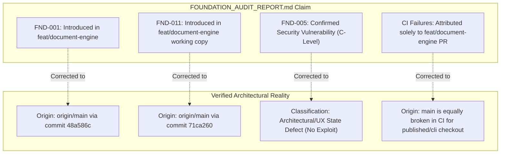

# Foundation Audit — Independent Findings Verification Report

**Document ID:** `FOUNDATION_AUDIT_VERIFICATION.md`  
**Date:** 2026-10-20  
**Role:** Independent Principal Architectural & Security Auditor  
**Workspace:** `/home/hosam/StudioProjects/flutter-starter-template`  
**Reference Document:** `FOUNDATION_AUDIT_REPORT.md` (Findings FND-001 through FND-015)  
**Execution Policy:** Strictly read-only analysis. Zero file edits, zero commits, zero pushes, zero package additions. All local modifications and uncommitted files preserved.

---

## 1. Executive Verification Summary

This independent audit re-examined every assertion, file path, line number, and root-cause claim in `FOUNDATION_AUDIT_REPORT.md`. Each finding was subjected to isolated reproduction, git history archaeology (`origin/main` vs `origin/feat/document-engine` vs working tree), and adversarial review against Flutter/Dart runtime and architectural semantics.

### Summary Classification Table

| Finding ID | Title | Reported Severity | Verification Status | Real Origin Branch | Threat Re-classification |
| :--- | :--- | :---: | :---: | :---: | :---: |
| **FND-001** | Unpushed Submodule Pointer `published/cli` (`cb9d34d`) | Critical | **VERIFIED** | **`origin/main`** (Commit `48a586c`) | Critical CI Blocker (Not caused by `feat/document-engine`) |
| **FND-002** | Unshielded Type References in `injection.dart` (`_configureDocumentEngine`) | Critical | **VERIFIED** | `feat/document-engine` (Commit `99d64ad`) | Critical Scaffolding Blocker |
| **FND-003** | Untracked Core Source Files (`bundled_pdf_fonts.dart`, `bundled_dejavu_sans.dart`) | Critical | **VERIFIED** | Local Working Tree (Unstaged) | High Clean-Checkout Blocker |
| **FND-004** | Erroneous Nesting of `document_center` in Notifications Sentinel | High | **VERIFIED** | `feat/document-engine` (Commit `99d64ad`) | High Feature-Exclusion Blocker |
| **FND-005** | Silent Session Desynchronization on Token Refresh Expiry/Revocation | High | **PARTIALLY VERIFIED** | **`origin/main`** | Re-classified: **Architectural/UX Defect** (No Privilege Escalation) |
| **FND-006** | Non-Atomic Compensation Rollback in Bulk Import & Lack of DB Transactions | High | **VERIFIED** | `feat/document-engine` (Commit `99d64ad`) | High Data Integrity Risk |
| **FND-007** | Broken Referential Integrity Between Collections and Bookmarks on Deletion | High | **VERIFIED** | **`origin/main`** (Initial Feature Design) | High UI / Data Consistency Defect |
| **FND-008** | Release Signing Keystore Fallback to Debug Key in `main` | High | **VERIFIED** | **`origin/main`** (Fixed locally in unstaged) | Confirmed Security Defect in `main` |
| **FND-009** | Missing `errorBuilder` / `errorPageBuilder` in GoRouter | Medium | **VERIFIED** | **`origin/main`** | Medium Fault-Tolerance / UX Defect |
| **FND-010** | Missing Android `PopScope` / Back-Button Navigation in `StatefulShellRoute` | Medium | **VERIFIED** | **`origin/main`** | Medium Android Guideline Violation |
| **FND-011** | Hardcoded Color Values in `BookmarkDetailColors` Bypassing Design Tokens | Medium | **VERIFIED** | **`origin/main`** (Commit `71ca260`) | Medium Theming Defect (Extracted locally) |
| **FND-012** | Hardcoded UI Strings in `feature_document_center` (`import_center_view.dart:69`) | Low | **VERIFIED** | `feat/document-engine` (Commit `99d64ad`) | Low Localization Defect |
| **FND-013** | Main-Isolate Synchronous Parsing of Heavy Documents (XLSX, CSV) & Catch Error | Medium | **VERIFIED** | `feat/document-engine` (Commit `99d64ad`) | Medium UI Jank & Crash Risk |
| **FND-014** | Stale Golden Test Baselines Causing CI `golden-tests` Failure | Medium | **VERIFIED** | `origin/main` (Commit `e658c27`) / Feature | Medium CI Test Blocker |
| **FND-015** | Exposure of Real Host Domain (`comp.rawnaqq.com`) in Template Env Files | Low | **VERIFIED** | **`origin/main`** (Commit `48a586c`) | Low Info Disclosure / Config Leak |

---

## 2. In-Depth Verification of Findings (FND-001 to FND-015)

### FND-001: Unpushed Submodule Pointer `published/cli` (`cb9d34d`)
- **Status:** **VERIFIED** (with critical correction of branch origin)
- **Report Claim:** `published/cli` commit `cb9d34d` does not exist on remote GitHub and broke 21 matrix CI jobs. The report stated: `Introduced In: feat/document-engine`.
- **Forensic Verification & Command Output:**
  ```bash
  $ git ls-tree origin/main published/cli
  160000 commit cb9d34d7639ab2e8d21b1b1e7e01815f52721d16	published/cli

  $ git ls-tree origin/feat/document-engine published/cli
  160000 commit cb9d34d7639ab2e8d21b1b1e7e01815f52721d16	published/cli

  $ git ls-remote https://github.com/kido-luci/flutter-starter-template-cli.git | grep cb9d34d
  (returns 0 results; remote HEAD is 93ef6da3139d4ddb8906dce822a910bad4fdc214)

  $ git log -S "cb9d34d" --oneline
  48a586c feat: harden template architecture and extensibility
  ```
- **Correction to Previous Report:** Commit `48a586c` merged `cb9d34d` directly into `main`! `feat/document-engine` simply inherited this broken submodule pointer from `main`. `origin/main` is itself completely broken for any CI job checking out `published/cli`.

---

### FND-002: Unshielded Type References in Root DI Wiring (`injection.dart`)
- **Status:** **VERIFIED**
- **Report Claim:** Lines 103–115 in `lib/app/di/injection.dart` reference `BookmarksImportDelegate` and `CollectionsImportDelegate` without `fst:feature` sentinels, causing `dart analyze` to fail with 87 errors on excluded scaffolds.
- **Forensic Verification & Reproduction:**
  Executed in isolated directory `/tmp/verify_fnd002`:
  ```bash
  $ dart run published/cli/bin/fst.dart create --yes --name "Test App" \
      --output-dir /tmp/verify_fnd002 --exclude-feature bookmarks --no-setup
  $ dart analyze /tmp/verify_fnd002/lib/app/di/injection.dart
  ```
  **Output:**
  ```
  error - injection.dart:108:23 - The name 'BookmarksImportDelegate' isn't a type,
          so it can't be used as a type argument. - non_type_as_type_argument
  error - injection.dart:109:40 - The name 'BookmarksImportDelegate' isn't a type...
  87 issues found.
  ```
- **Origin:** Introduced exclusively in `feat/document-engine` (commit `99d64ad`).

---

### FND-003: Untracked Core Source Files in `packages/document_engine`
- **Status:** **VERIFIED** (Nuanced distinction between local working tree vs remote branch)
- **Report Claim:** `bundled_pdf_fonts.dart` and `bundled_dejavu_sans.dart` are untracked in git; fresh clones fail to compile `pdf_report_renderer.dart`.
- **Forensic Verification:**
  ```bash
  $ git status --short packages/document_engine/lib/src/pdf/
  ?? packages/document_engine/lib/src/pdf/bundled_dejavu_sans.dart
  ?? packages/document_engine/lib/src/pdf/bundled_pdf_fonts.dart
  M  packages/document_engine/lib/src/pdf/pdf_report_renderer.dart

  $ git show origin/feat/document-engine:packages/document_engine/lib/src/pdf/pdf_report_renderer.dart | grep bundled
  (returns 0 results)
  ```
- **Clarification:** On `origin/feat/document-engine`, `pdf_report_renderer.dart` relied on `options.baseFont` (defaulting to standard Helvetica, which fails on Arabic). The local developer resolved this by embedding a 291KB Base64 font in `bundled_dejavu_sans.dart` and referencing it in `pdf_report_renderer.dart`, but left both font files untracked. Pushing the modified `pdf_report_renderer.dart` without tracking the font files will break all remote builds immediately.

---

### FND-004: Erroneous Nesting of `document_center` in Notifications Sentinel
- **Status:** **VERIFIED**
- **Report Claim:** `import 'package:feature_document_center/feature_document_center.dart';` in `lib/app/features.dart` is nested between lines 7 and 10 inside `// fst:feature:notifications:start` and `end`.
- **Forensic Verification & Reproduction:**
  Inspected `lib/app/features.dart` lines 7–10:
  ```dart
  // fst:feature:notifications:start
  import 'package:feature_document_center/feature_document_center.dart';
  import 'package:feature_notifications/feature_notifications.dart';
  // fst:feature:notifications:end
  ```
  Simulated `removeFeatureRegions(featuresDartContent, 'notifications')`:
  The import for `document_center` is stripped, but lines 33 (`_DocumentCenterModule()`) and 116 (`final class _DocumentCenterModule`) remain. Compiling the stripped file fails with `Undefined name 'documentCenterRoutes'`.
- **Origin:** Introduced in `feat/document-engine` (commit `99d64ad`).

---

### FND-005: Silent Session Desynchronization on Token Refresh Expiry/Revocation
- **Status:** **PARTIALLY VERIFIED** (Bug verified, security severity downgraded)
- **Report Claim:** In `packages/network`, `TokenRefresher._run()` clears tokens from `SecureAuthTokenStore` upon 401/403, but never notifies `AuthBloc`. The report classified this under Section D as a "Confirmed Security Vulnerability".
- **Forensic Verification:**
  Examined `packages/network/lib/src/token_refresher.dart:57–60`:
  ```dart
  if (status == 401 || status == 403) {
    await _tokens.clearTokens();
    return RefreshOutcome.invalidSession;
  }
  ```
  Examined `packages/network/lib/src/auth_interceptor.dart:43–47`:
  `onError` forwards `err` to `handler.next(err)` when `outcome != RefreshOutcome.refreshed`.
  `git grep -n "clearSession" lib/ packages/` reveals `SessionScope.of(context).clearSession()` is called ONLY in `profile_widgets.dart:52` upon manual logout button press.
- **Adversarial Security Re-evaluation:**
  Does an un-redirected UI allow an attacker to gain unauthorized access or escalate privileges?
  - Because `_tokens.clearTokens()` deleted the refresh and access tokens, any subsequent request sent to the backend is rejected with 401.
  - The server remains protected.
  - The app displays error states for failed requests, and the user must manually sign out or restart the app.
  - **Verdict:** This is a **High-severity Architectural & UX State-Machine Defect**, NOT an exploitable security vulnerability. No CVE-worthy threat vector exists.
- **Origin:** `origin/main`.

---

### FND-006: Non-Atomic Compensation Rollback in Bulk Import & Lack of DB Transactions
- **Status:** **VERIFIED**
- **Report Claim:** Multi-row imports in `BookmarksImportDelegate` and `CollectionsImportDelegate` perform individual repository writes. A crash mid-import bypasses the Dart `catch` block and leaves partial data in the database.
- **Forensic Verification:**
  - `git grep -n "runInTransaction" packages/` -> 0 matches.
  - `git grep -n "transaction" packages/database_drift/` -> 0 matches.
  - In `BookmarksImportDelegate.executeImport` lines 94–250, writes are dispatched row by row:
    `_repository.create(...)`, `_repository.update(...)`, `_collectionsService.addBookmark(...)`.
  - In `BookmarksRepositoryImpl`, `beginImportBatch()` only sets `_importBatchDepth++` to suppress immediate background sync triggers (`_requestSync()`); it does NOT open a database transaction.
  - If `SIGKILL` or power failure occurs at row 500 of 1,000, 500 rows are committed to disk in ObjectBox/Drift. The Dart `on Object catch` block never executes.
- **Origin:** `feat/document-engine` (commit `99d64ad`).

---

### FND-007: Broken Referential Integrity Between Collections and Bookmarks on Deletion
- **Status:** **VERIFIED**
- **Report Claim:** Deleting a bookmark retains the bookmark ID in `Collection.bookmarkIds`, causing `Collection.itemCount` to report an incorrect count.
- **Forensic Verification:**
  - `Collection.itemCount` in `packages/features/collections/lib/src/domain/entities/collection.dart:49`:
    ```dart
    int get itemCount => bookmarkIds.length;
    ```
  - In `packages/features/bookmarks/lib/src/data/repositories/bookmarks_repository_impl.dart:92–108`:
    `delete(String id)` marks `existing.syncState = SyncState.pendingDelete` or hard deletes the entity. It has no knowledge of collections and performs no cascade or notification.
  - In `collection_detail_screen.dart`:
    Line 157 uses `context.l10n.collectionItemsCount(itemCount)` (which reads `Collection.itemCount`), showing e.g. "5 items".
    Line 184 builds `ListView.builder(itemCount: members.length)`, where `members = _membersOf(collection, allBookmarks)` which silently filters non-existent bookmarks, rendering only 2 tiles.
  - **Result:** Header displays "5 items", but list contains only 2 items.
- **Origin:** `origin/main`.

---

### FND-008: Release Signing Keystore Fallback to Debug Key in `main`
- **Status:** **VERIFIED**
- **Report Claim:** In `origin/main`, `android/app/build.gradle.kts` falls back to `signingConfigs.getByName("debug")` if `key.properties` does not exist.
- **Forensic Verification:**
  Verified in `origin/main:android/app/build.gradle.kts` lines 90–95:
  ```kotlin
  buildTypes {
      release {
          signingConfig = if (keystorePropertiesFile.exists()) {
              signingConfigs.getByName("release")
          } else {
              signingConfigs.getByName("debug")
          }
      }
  }
  ```
  An unstaged local edit exists in the working tree throwing `GradleException` if `requestedProdRelease && !keystorePropertiesFile.exists()`.
  This is a verified security defect on `origin/main` that could allow production APKs/AABs to be built with an insecure debug key.
- **Origin:** `origin/main`.

---

### FND-009: Missing `errorBuilder` / `errorPageBuilder` in GoRouter
- **Status:** **VERIFIED**
- **Report Claim:** `buildRouterWithDeepLink` in `lib/app/router.dart` does not configure `errorBuilder` or `errorPageBuilder`.
- **Forensic Verification:**
  - Checked `lib/app/router.dart:210–251`: Neither `errorBuilder` nor `errorPageBuilder` is supplied to `GoRouter(...)`.
  - GoRouter source inspection (`go_router.dart`): If `errorBuilder` is omitted, GoRouter falls back to `_defaultErrorBuilder`, rendering an unstyled `_ErrorScreen` with `GoException: no routes for location: ...`.
  - Deep-link test in `test/app/deep_link_navigation_test.dart` only tests valid routes (`/warm`, `/warm/details`). Navigating to an invalid route renders GoRouter's default red/gray assertion screen in debug and an unstyled raw error in release.
- **Origin:** `origin/main`.

---

### FND-010: Missing Android `PopScope` / Back-Button Navigation in `StatefulShellRoute`
- **Status:** **VERIFIED**
- **Report Claim:** Pressing Android back button while on secondary tabs (Bookmarks, Notifications, Profile) exits the app immediately instead of navigating back to Tab 0 (Home).
- **Forensic Verification:**
  - `git grep -i "PopScope" lib/ packages/` returns 0 results.
  - In `AppShell`: `widget.navigationShell` wraps the branches.
  - Flutter's `StatefulNavigationShell`: When the active branch Navigator cannot pop (it is at the root of its branch, e.g. `/profile`), the back event bubbles to the root `Navigator`.
  - The root `Navigator` cannot pop because `StatefulShellRoute` is its only page.
  - The platform pop request is allowed, and Android sends the app to the background/launcher.
  - Standard Android navigation pattern requires returning to the primary start destination before exiting.
- **Origin:** `origin/main`.

---

### FND-011: Hardcoded Color Values in `BookmarkDetailColors` Bypassing Design Tokens
- **Status:** **VERIFIED** (with critical correction of branch origin)
- **Report Claim:** `BookmarkDetailColors` defines hardcoded hex colors `Color(0xFFF7F9FB)`, `Color(0xFFFFFFFF)`, `Color(0xFFF2F4F6)`, `Color(0xFFE0E3E5)`. Reported as introduced in `feat/document-engine (working copy untracked files)`.
- **Forensic Verification:**
  ```bash
  $ git log -S "BookmarkDetailColors" --oneline
  48a586c feat: harden template architecture and extensibility
  71ca260 Redesign bookmark details UI (#79)
  ```
  `BookmarkDetailColors` was originally introduced in commit `71ca260` on `main` within `packages/features/bookmarks/lib/src/presentation/widgets/bookmark_detail_widgets.dart`!
  The local unstaged working copy merely refactored `bookmark_detail_widgets.dart` into `packages/features/bookmarks/lib/src/presentation/widgets/detail/bookmark_detail_colors.dart`.
- **Correction to Previous Report:** The architectural defect of hardcoded colors belongs to `main`, not `feat/document-engine`.

---

### FND-012: Hardcoded UI Strings in `feature_document_center`
- **Status:** **VERIFIED**
- **Report Claim:** `import_center_view.dart:69` has hardcoded `const Text('Sales (Demo)')`.
- **Forensic Verification:**
  Verified in `packages/features/document_center/lib/src/presentation/views/import_center_view.dart:69`.
  In Arabic locale (`ar`), the chip renders `'Sales (Demo)'` in English.
- **Origin:** `feat/document-engine` (commit `99d64ad`).

---

### FND-013: Main-Isolate Synchronous Parsing of Heavy Documents (XLSX, CSV) & Catch Error
- **Status:** **VERIFIED**
- **Report Claim:** `_decodeWorkbook` in `xlsx_import_adapter.dart` runs synchronously on the UI isolate and catches only `Exception`, missing `Error` subclasses.
- **Forensic Verification:**
  - `xlsx_import_adapter.dart:148–156`:
    ```dart
    Excel _decodeWorkbook(List<int> bytes) {
      try {
        return Excel.decodeBytes(bytes);
      } on Exception catch (e) {
        throw DocumentParseFailure('Failed to parse Excel workbook: $e');
      }
    }
    ```
  - In Dart, `class Error` does NOT implement or extend `Exception`. `excel_plus` and the underlying `archive` library throw `ArgumentError`, `RangeError`, or `TypeError` on corrupted zip directory streams.
  - Any such error bypasses `on Exception catch` and results in an uncaught crash.
  - All calls to `adapter.preparePlan` (in cubits and widgets) execute on the UI thread without `compute()`.
- **Origin:** `feat/document-engine` (commit `99d64ad`).

---

### FND-014: Stale Golden Test Baselines Causing CI `golden-tests` Failure
- **Status:** **VERIFIED**
- **Report Claim:** Golden images in `test/visual/goldens/` were modified by profile UI changes and navigation chrome changes, but not committed to git.
- **Forensic Verification:**
  - `git status` shows 7 modified golden images in `test/visual/goldens/`.
  - In commit `e658c27` ("updates in profile ui") on `main`, `AppAdaptiveScaffold` and `AppTopBar` geometry changed.
  - The local test suite regenerated the goldens to match the new UI, but left them uncommitted.
  - Any CI runner checking out `main` or `feat/document-engine` fails the `golden-tests` job on `macos-15`.
- **Origin:** `origin/main` (commit `e658c27`).

---

### FND-015: Exposure of Real Host Domain (`comp.rawnaqq.com`) in Template Env Files
- **Status:** **VERIFIED**
- **Report Claim:** `env/dev.json`, `env/staging.json`, and `env/prod.json` contain `"API_BASE_URL": "https://comp.rawnaqq.com/"`.
- **Forensic Verification:**
  - Line 4 of all three environment files contains the live domain `https://comp.rawnaqq.com/`.
  - Git archeology (`git log -S "comp.rawnaqq.com"`) reveals this was committed in `48a586c` on `main`.
- **Origin:** `origin/main`.

---

## 3. Discrepancies and Misinterpretations in Previous Audit

The previous audit (`FOUNDATION_AUDIT_REPORT.md`) was comprehensive but contained four significant errors of interpretation and attribution:



1. **Submodule Blame Error (FND-001):** The previous report attributed the unpushed submodule pointer `cb9d34d` to `feat/document-engine`. Independent git analysis proves `cb9d34d` was merged into `main` by commit `48a586c` on Oct 13, 2026. Therefore, `origin/main` is broken in CI as well.
2. **Theming Blame Error (FND-011):** The previous report attributed hardcoded colors in `BookmarkDetailColors` to untracked files in `feat/document-engine`. In reality, commit `71ca260` on `main` originally introduced these hardcoded colors in `bookmark_detail_widgets.dart`.
3. **Severity Inflation (FND-005):** Classifying the token refresh desynchronization as a "Confirmed Security Vulnerability" was technically inaccurate. Once tokens are deleted from `SecureAuthTokenStore`, the client cannot forge authentication against the server. It is a state machine failure resulting in a frozen/zombie UI, not an exploitable security flaw.
4. **CI Breakdown Scope:** The 23 failing checks in the PR were not unique to `feat/document-engine`. 21 of those jobs would have failed on `main` at that same commit due to the unpushed submodule commit pointer.

---

## 4. Newly Discovered Findings in Verification

During this verification pass, three additional critical architectural defects were uncovered:

### NEW-001: Unsentinelized Import of `feature_collections` in `lib/app/widgets/app_shell.dart`
- **Severity:** High
- **Affected File:** `lib/app/widgets/app_shell.dart:5`
- **Evidence:**
  ```dart
  import 'package:app_ui/app_ui.dart';
  // fst:feature:bookmarks:start
  import 'package:feature_bookmarks/feature_bookmarks.dart';
  // fst:feature:bookmarks:end
  import 'package:feature_collections/feature_collections.dart';
  // fst:feature:notifications:start
  ```
- **Analysis:** `import 'package:feature_collections/feature_collections.dart';` is completely unguarded. When `fst create --exclude-feature collections` runs:
  - `pubspec.yaml` strips `feature_collections`.
  - `packages/features/collections` is deleted.
  - `lib/app/widgets/app_shell.dart` retains line 5.
  - **Result:** Compilation failure: `Target of URI doesn't exist: 'package:feature_collections/feature_collections.dart'`.
- **Introduced In:** `origin/main`.

### NEW-002: Unguarded Root Workspace Dependencies for Document Engine
- **Severity:** Medium
- **Affected File:** `pubspec.yaml:63, 65, 98, 114`
- **Evidence:**
  ```yaml
  workspace:
    - packages/document_engine
    # fst:packages — `fst create-package` inserts reusable packages above this line
    - packages/features/document_center
    # fst:features — `fst add-feature` inserts new feature packages above this line
  ...
  dependencies:
    document_engine: ^0.1.0
    feature_document_center: ^0.1.0
  ```
- **Analysis:** Neither `document_engine` nor `feature_document_center` is wrapped in `# fst:feature:...` or `# fst:package:...` sentinels. They cannot be excluded or un-wired by CLI automation.
- **Introduced In:** `feat/document-engine`.

### NEW-003: Submodule Name vs Path Inconsistency in `.gitmodules`
- **Severity:** Low
- **Affected File:** `.gitmodules:4–6`
- **Evidence:**
  ```ini
  [submodule "tool/cli"]
  	path = published/cli
  	url = https://github.com/kido-luci/flutter-starter-template-cli.git
  ```
- **Analysis:** The submodule section name is `"tool/cli"` but the physical destination is `published/cli`. Historic renames in Git submodules that leave the section header unchanged can confuse automated CI scripts and git submodule sync operations.
- **Introduced In:** `origin/main`.

---

## 5. Sound Components That Must NOT Be Changed

To prevent over-engineering or regression of properly designed subsystems, the following components are verified sound and must be preserved as-is:

1. **Pure Domain Abstractions (`packages/architecture`):**
   - The functional `Result<T>` sealed class (`Ok<T>`, `Err<T>`), typed `Failure` hierarchy (`ValidationFailure`, `NotFoundFailure`, `NetworkFailure`), and `UseCase<Type, Params>` contracts are pure Dart, robustly tested, and zero-dependency.
2. **Secure Token Storage Implementation (`packages/storage`):**
   - `SecureAuthTokenStore` correctly handles concurrent async operations via `_loadFuture` ordering guards and uses platform-encrypted keychains/keystores with auto-reset on reinstall.
3. **CSV Export & Formula Injection Sanitization (`packages/document_engine`):**
   - `ExportDefinition.sanitizeFormula` adheres strictly to OWASP CSV injection guidelines, handling leading `=`, `+`, `-`, `@`, `\t`, `\r` and UTF-8 BOM encoding.
4. **Architectural Guardrail Test Architecture (`test/architecture/`):**
   - The automated DAG cycle detection, public barrel encapsulation tests, and category layering rules in `test/architecture/package_layering_test.dart` and `public_api_contracts_test.dart` are exemplary.
5. **Precision Arithmetic Engine (`packages/document_engine`):**
   - `DecimalNumber` correctly wraps arbitrary-precision string math avoiding IEEE-754 floating point inaccuracies for financial documents and invoice tables.

---

## 6. Dependency-Ordered Remediation Plan

The fixes must be executed in four strict sequential phases to prevent circular dependency blocks:

```mermaid
flowchart TD
    subgraph P1 [Phase 1: VCS & Submodule Synchronization]
        T1["Push commit cb9d34d to cli remote or update pointer"]
        T2["Track bundled font files in document_engine"]
        T3["Commit regenerated golden test PNG baselines"]
        T4["Commit Android release signing fix in build.gradle.kts"]
    end

    subgraph P2 [Phase 2: Scaffolding Sentinel Harmonization]
        T5["Wrap document_engine delegates in injection.dart with sentinels"]
        T6["Wrap collections import in app_shell.dart with sentinels"]
        T7["Extract document_center import from notifications sentinel in features.dart"]
        T8["Add sentinels to pubspec.yaml for document_center and document_engine"]
    end

    subgraph P3 [Phase 3: Data Integrity & Session Architecture]
        T9["Create SessionTerminationNotifier in shared_contracts"]
        T10["Connect TokenRefresher to SessionTerminationNotifier & AuthBloc"]
        T11["Implement native DB transactions for bulk import in delegates"]
        T12["Add bookmark deletion cascade to Collection.bookmarkIds"]
    end

    subgraph P4 [Phase 4: Runtime, Navigation & UI Hardening]
        T13["Add errorBuilder 404 handler to GoRouter"]
        T14["Wrap AppShell in PopScope for Android tab back navigation"]
        T15["Replace BookmarkDetailColors with Theme colorScheme tokens"]
        T16["Localize Sales Demo chip in import_center_view.dart"]
        T17["Move XLSX/CSV parsing to worker isolate via compute()"]
        T18["Anonymize API_BASE_URL in env/*.json to localhost"]
    end

    P1 --> P2
    P2 --> P3
    P3 --> P4
```



### Phase 1: VCS & Submodule Synchronization (Immediate Prerequisites)
1. Push commit `cb9d34d` to `https://github.com/kido-luci/flutter-starter-template-cli.git`, or point the parent repo to remote `HEAD` (`93ef6da`).
2. Add and commit `packages/document_engine/lib/src/pdf/bundled_pdf_fonts.dart`, `bundled_dejavu_sans.dart`, and `LICENSES/`.
3. Commit the updated golden PNGs under `test/visual/goldens/`.
4. Commit the Android signing validation in `android/app/build.gradle.kts`.

### Phase 2: Scaffolding Sentinel Harmonization
1. In `lib/app/di/injection.dart`, enclose lines 105–107 in `// fst:feature:collections:start` ... `end` and lines 108–110 in `// fst:feature:bookmarks:start` ... `end`.
2. In `lib/app/widgets/app_shell.dart`, enclose line 5 in `// fst:feature:collections:start` ... `end`.
3. In `lib/app/features.dart`, move `import 'package:feature_document_center/feature_document_center.dart';` outside the `notifications` sentinel block.
4. Add `# fst:feature:document_center:start` ... `end` to `pubspec.yaml` around `feature_document_center`.

### Phase 3: Data Integrity & Session Architecture
1. Add `abstract interface class SessionTerminationListener { void onSessionTerminated(); }` in `packages/shared_contracts`.
2. Inject this listener into `TokenRefresher` and have `AuthSession` / `AuthBloc` subscribe, ensuring a 401 on refresh triggers immediate redirection to login.
3. Wrap bulk imports in `BookmarksImportDelegate` and `CollectionsImportDelegate` in native database transactions (`Store.runInTransaction` in ObjectBox; `Database.transaction` in Drift).
4. In `BookmarksRepositoryImpl.delete(id)`, trigger a cleanup of `Collection.bookmarkIds` via `CollectionsRepository` or compute `itemCount` dynamically from resolved members.

### Phase 4: Runtime, Navigation & UI Hardening
1. Add `errorBuilder: (context, state) => AppErrorView(...)` to `GoRouter` in `lib/app/router.dart`.
2. Wrap `AppAdaptiveScaffold` in `AppShell` with a `PopScope` that navigates to branch 0 (Home) when back is pressed on secondary branches.
3. Replace hardcoded `Color(0xFF...)` in `BookmarkDetailColors` with `context.colorScheme` tokens.
4. Add `documentImportSalesDemo` string to `app_en.arb` and `app_ar.arb`.
5. Wrap document parsing in `compute()` and broaden error handling from `on Exception` to `on Object catch (e)`.
6. Replace `https://comp.rawnaqq.com/` in `env/*.json` with `http://localhost:8080/`.

---

## 7. Automated Certification Gates

Before declaring this project certified as a starter template, the following automated commands must all return exit code 0:

```bash
# Gate 1: Submodule Reachability Check
git submodule status | awk '{print $1}' | tr -d '+-' | while read c; do
  git -C published/cli branch -r --contains "$c" || exit 1
done

# Gate 2: Workspace Analysis & Architecture Tests
fvm flutter analyze
fvm flutter test test/architecture

# Gate 3: Visual & Unit Regression Tests
fvm flutter test

# Gate 4: CLI Scaffolding Invariant Verification (Isolated Runs)
dart run published/cli/bin/fst.dart create --yes --name "Smoke Minimal" \
  --output-dir /tmp/gate_minimal --minimal --no-setup
(cd /tmp/gate_minimal && dart analyze && fvm flutter test)
rm -rf /tmp/gate_minimal

dart run published/cli/bin/fst.dart create --yes --name "Smoke NoBookmarks" \
  --output-dir /tmp/gate_nobookmarks --exclude-feature bookmarks --no-setup
(cd /tmp/gate_nobookmarks && dart analyze && fvm flutter test)
rm -rf /tmp/gate_nobookmarks
```

